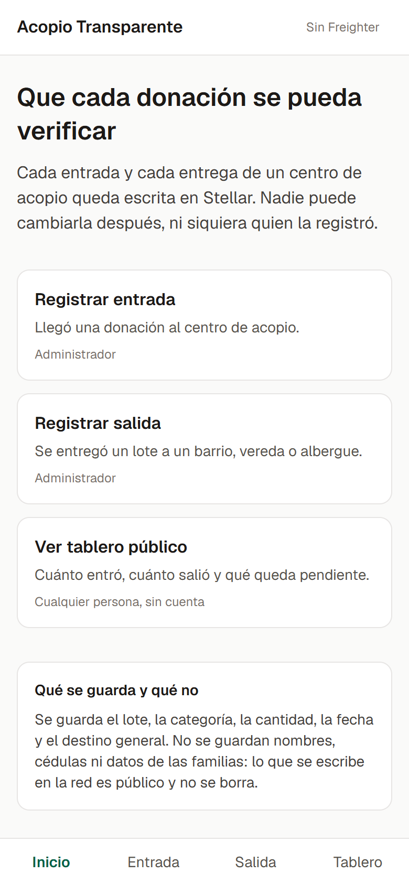
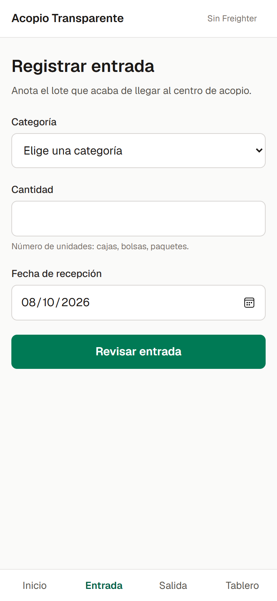
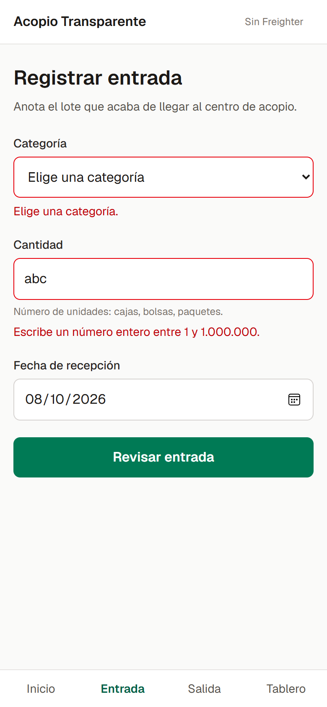
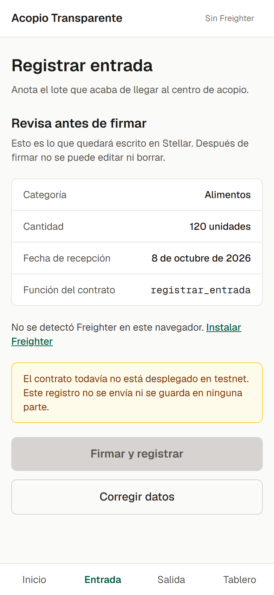
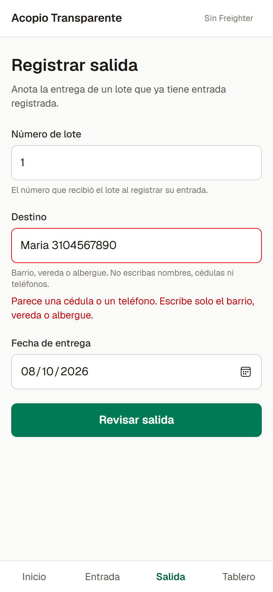
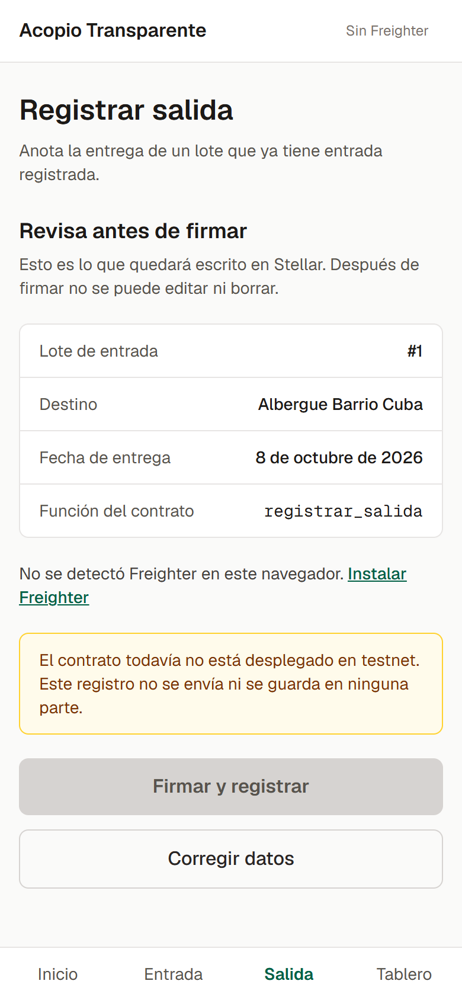
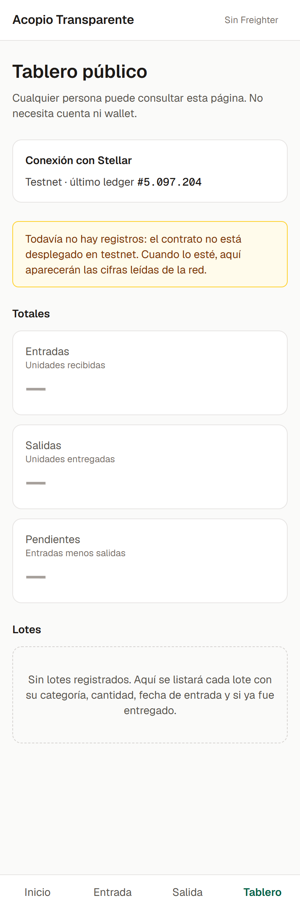
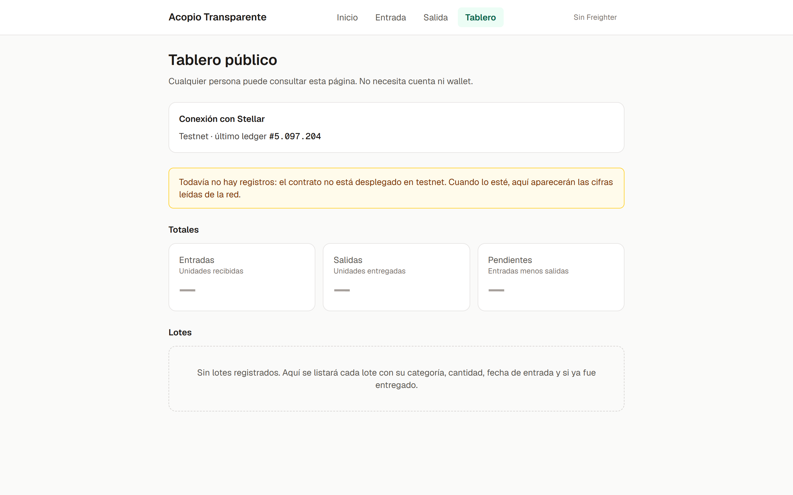

# Documentación — Semana 3: Functional Proof

Proyecto: **Acopio Transparente**. Trabajo individual.

## Front construido

El front está en la carpeta `frontend/` del repositorio. Es una aplicación Next.js 15 (App Router) con TypeScript estricto, pensada primero para celular, porque quien registra es un voluntario con la donación en la mano. En celular la navegación va en la parte inferior, al alcance del pulgar; en pantallas anchas sube al encabezado.

Implementé cuatro pantallas, que cubren el flujo principal del MVP definido en el Product Blueprint (entrada → salida → consulta).

### 1. Inicio (`/`)

Explica en dos frases para qué sirve la aplicación y lleva a cada paso del flujo. Cada acceso indica quién lo usa: el administrador registra, cualquier persona consulta. También aclara qué se guarda en la red y qué no, que es el criterio de datos del proyecto.

### 2. Registrar entrada (`/entrada`)

Corresponde al paso 1 del flujo del Blueprint y a la historia "Administrador registra la entrada de un lote". El formulario pide los tres datos definidos para el contrato: categoría, cantidad y fecha de recepción.

Antes de avanzar se valida todo: la categoría debe ser una de la lista, la cantidad un número entero entre 1 y 1.000.000, y la fecha debe existir y no ser futura. Los errores aparecen junto al campo que falló.

Si los datos son válidos se pasa a una pantalla de revisión, que muestra exactamente lo que quedará escrito en Stellar, la función del contrato que lo recibirá (`registrar_entrada`) y la cuenta de Freighter que firmará. Este paso existe porque el registro no se puede corregir después de firmado.

### 3. Registrar salida (`/salida`)

Corresponde al paso 3 del flujo y a la historia que marqué como la más importante: "Administrador registra la salida de un lote". Pide el número del lote de entrada, el destino y la fecha de entrega. El número de lote es lo que enlaza la salida con su entrada.

El destino es un lugar general (barrio, vereda o albergue), nunca una persona. El formulario rechaza el texto si parece contener una cédula o un teléfono, porque lo que se escribe en la red es público y no se borra.

### 4. Tablero público (`/tablero`)

Corresponde al paso 4 del flujo y a la historia "Donante consulta si su donación fue entregada". No pide wallet ni cuenta. Tiene tres partes: la conexión con Stellar, los totales (entradas, salidas y pendientes) y la lista de lotes.

La conexión es real: la pantalla consulta Horizon en testnet cada diez segundos y muestra el número del último ledger. Los totales y la lista aparecen vacíos, con un aviso que explica por qué: todavía no hay contrato desplegado, así que no existe ningún registro que leer. Decidí no mostrar cifras de ejemplo, porque un tablero de transparencia con números inventados contradice el propósito del proyecto.

### Conexión con Freighter

El encabezado muestra el estado de la wallet en todas las pantallas: si la extensión no está instalada, si falta conectarla, o la dirección de la cuenta conectada. En la pantalla de revisión también se comprueba que Freighter esté en Testnet y se avisa si está en otra red. Las capturas de este documento se tomaron en un navegador sin la extensión, por eso muestran "Sin Freighter".

### Qué funciona hoy y qué no

| Parte | Estado |
|---|---|
| Navegación entre las cuatro pantallas | Funciona |
| Validación de los formularios | Funciona |
| Lectura del estado de testnet desde Horizon | Funciona, con datos reales |
| Conexión con Freighter | Funciona, probada con la extensión en Testnet |
| Firmar y enviar un registro | Deshabilitado hasta desplegar el contrato |
| Totales y lista de lotes en el tablero | Vacíos hasta desplegar el contrato |

El botón "Firmar y registrar" está deshabilitado a propósito y la pantalla avisa que el registro no se envía ni se guarda en ninguna parte.

## Decisión técnica

**Opción elegida: A, contrato propio.**

### Qué haría el contrato

Un contrato en Rust sobre Soroban, desplegado en testnet, con dos funciones:

- `registrar_entrada(categoria, cantidad, fecha)`: guarda un lote nuevo y le asigna un identificador.
- `registrar_salida(id_lote, destino, fecha)`: guarda la entrega de un lote que ya existe, enlazada a su entrada por ese identificador.

En la red quedaría solo lo que varias partes necesitan verificar: lote, categoría, cantidad, fecha y destino general. Ningún dato personal.

### Por qué hace falta uno propio

El Product Blueprint ya definía Soroban como la pieza que aloja la lógica, y las razones siguen siendo las mismas:

1. **Enlazar salida con entrada.** La pregunta que responde el proyecto es "¿llegó o no llegó la donación?". Para responderla, cada salida tiene que apuntar a un lote que exista. Esa comprobación es lógica propia del producto.
2. **Evitar registros repetidos o inválidos.** El contrato puede rechazar una salida para un lote inexistente o un lote que ya fue entregado. Así el historial no depende de que el administrador digite bien.
3. **Autor identificable.** El contrato puede exigir la firma de la cuenta del centro de acopio, de modo que cada registro tenga un responsable sin que la aplicación maneje contraseñas.
4. **Registro inalterable.** El contrato no tendrá funciones para editar ni borrar. Esa es la garantía de la historia 7 del Blueprint.

### Qué descarté

- **Pagos nativos de Stellar con un memo.** Sirven para dejar constancia de un movimiento, pero no validan nada: no pueden comprobar que el lote exista ni impedir una salida duplicada. Toda la validación quedaría en el front, que es justo la parte que controla el administrador.
- **Una plataforma existente del ecosistema (opción B).** No encontré una herramienta de Stellar hecha para trazabilidad de inventario de donaciones. Las soluciones existentes se enfocan en pagos y en distribución de dinero, y este proyecto no mueve dinero: registra entradas y salidas de bienes físicos.

Del ecosistema sí uso dos piezas ya hechas, como estaba previsto en el Blueprint: Freighter para firmar y Horizon para leer la red.

## Participación del equipo

| Integrante | GitHub | Aporte |
|---|---|---|
| Gustavo Adolfo Arcila Trujillo | `tavoarcila` | Proyecto individual: diseño y construcción del front, decisión técnica, documentación y README. |

## Bloqueos y siguiente paso

**Pendiente:**

- Definir cómo leerá el tablero los registros del contrato. El Blueprint dice Horizon, pero el estado y los eventos de un contrato Soroban se consultan por Stellar RPC, que además guarda un historial limitado de eventos. Hay que confirmarlo antes de construir la lectura.
- Decidir si la historia 1 del Blueprint (el donante registra su propia salida) entra al contrato o queda para después. Hoy el diseño tiene solo las dos funciones del administrador.

**Siguiente paso:** escribir el contrato con sus pruebas, desplegarlo en testnet y conectar el front: habilitar la firma con Freighter en los dos formularios y llenar el tablero con los datos leídos de la red.
